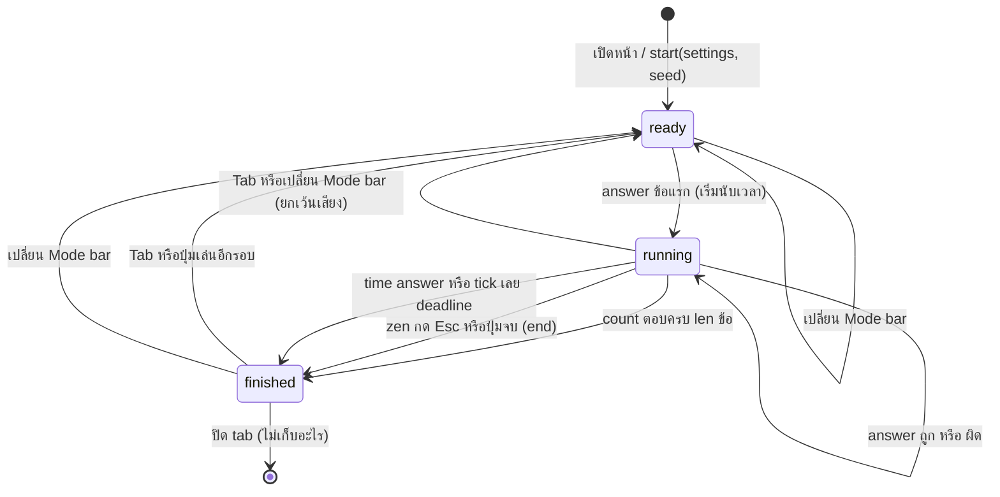
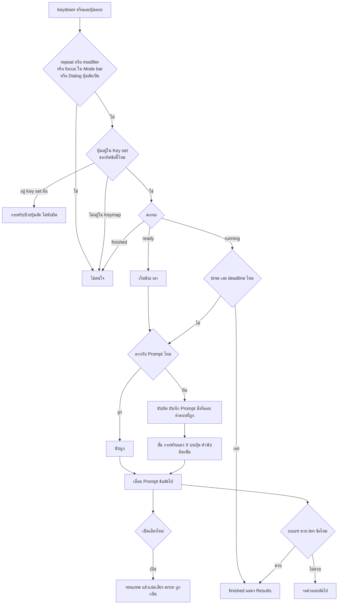
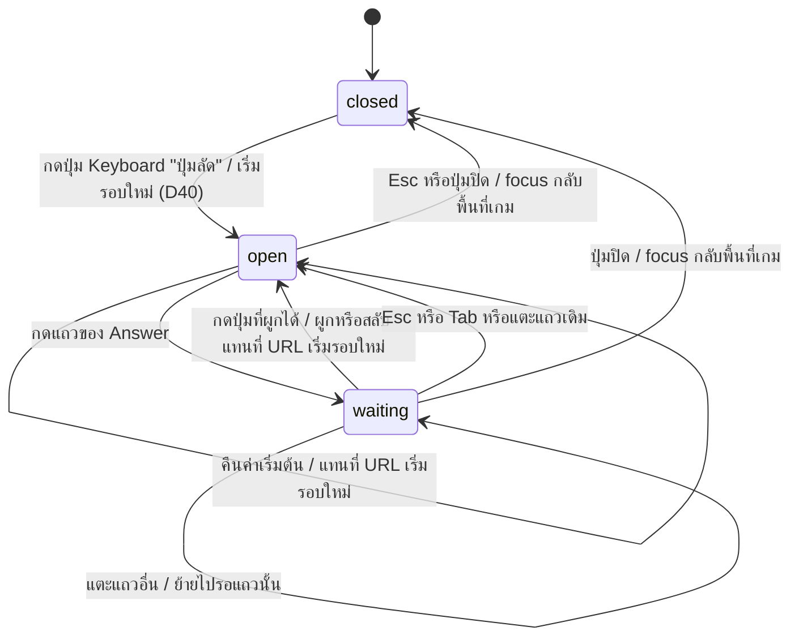

# Flow: note-name-quiz

3 diagrams, read in this order:
1. สถานะของรอบ ตั้งแต่เปิดหน้าจนถึงหน้า Results
2. สิ่งที่เกิดเมื่อผู้เล่นกดปุ่มหรือแตะปุ่มตอบหนึ่งครั้ง
3. การตั้ง Keymap ใน Dialog "ปุ่มลัด"

All diagrams use the same names as [spec.md](spec.md).

## 1. สถานะของรอบ

**รอบหนึ่งเริ่ม จบ และเริ่มใหม่เมื่อไร**
- `finished` แสดงหน้า Results ค่าตาม D15
- answer หลัง `finished` ไม่มีผล (spec.md › Engine contract)
- ปิด tab แล้วผลหายหมด (D4)
- เปลี่ยน Mode bar → แทนที่ URL แล้วเริ่มรอบใหม่ ยกเว้นเปิดปิดเสียงที่รอบเดิมเล่นต่อ (D14, D16, D20)
- `time` จบที่ `deadline` เสมอ แม้ `tick` มาช้า คำตอบหลัง deadline ไม่นับ (D20)

## 2. ตอบหนึ่งครั้ง

**ปุ่มหนึ่งครั้งกลายเป็นผลอะไร**
- อ่านปุ่มจาก `KeyboardEvent.code` คีย์บอร์ดภาษาไทยก็ตอบได้ (D14)
- ทิศโด→C ตอบด้วย Key set letter ทิศ C→โด ตอบด้วย Key set solfège ตาม Keymap ใน URL (D32, D34)
- `Numpad{n}` เป็นปุ่มเดียวกับ `Digit{n}` (D32)
- กดผิด Key set กระพริบเฉพาะทิศสลับ ทิศคงที่ไม่มีอะไรเกิด (D26)
- ปุ่มแตะบนจอเข้าทางเดียวกับคีย์บอร์ด (D6)
- สร้าง `AudioContext` ตอนกดเปิดเสียง engine อัปเดตก่อนเล่นเสียงเสมอ (D5, D20)
- `Tab` กับ `Esc` ไปที่ diagram 1 ไม่ผ่านแผนภาพนี้ (D20)

## 3. ตั้ง Keymap

**Dialog รับปุ่มอย่างไร**
- ขณะ Dialog เปิด (`open` หรือ `waiting`) ปุ่มไม่ถึงเกม ไม่ตอบ ไม่เริ่มรอบ ไม่จบรอบ (D35)
- ปุ่มที่ผูกได้คือ 47 ปุ่มใน D33 ; `repeat` หรือ modifier ค้างไม่นับ (D20)
- ปุ่มที่ Answer อื่นใช้อยู่ → สองตัวสลับกัน (D36)
- เปิด Dialog และทุกการเปลี่ยนเริ่มรอบใหม่ เวลาไม่เดินระหว่างเปิด (D37, D40)
- listener ของเกมเลิกเมื่อ `e.defaultPrevented` หรือ ref "Dialog เปิด" — `Esc` ที่ปิด Dialog ไม่จบรอบ `zen` (D35)
- มือถือไม่มีคีย์บอร์ดอยู่ที่ `waiting` จนแตะแถวหรือปิด Dialog (D39)
