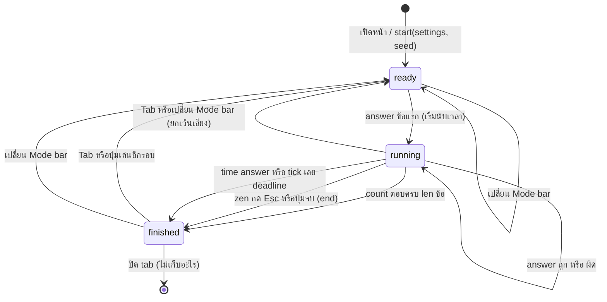
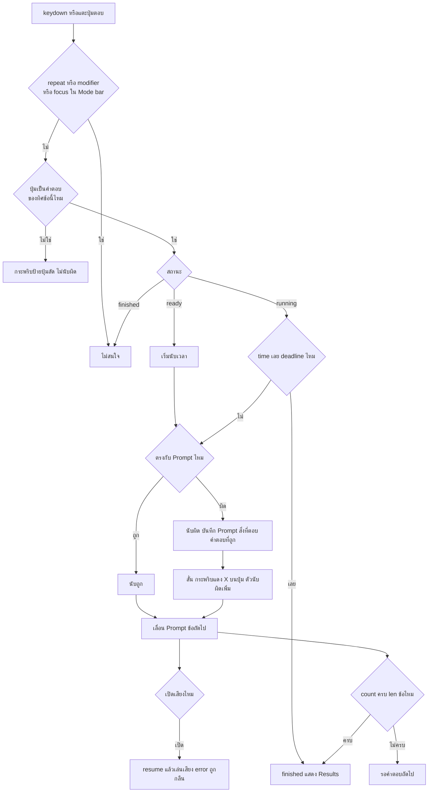

# Flow: note-name-quiz

2 diagrams, read in this order:
1. สถานะของรอบ ตั้งแต่เปิดหน้าจนถึงหน้า Results
2. สิ่งที่เกิดเมื่อผู้เล่นกดปุ่มหรือแตะปุ่มตอบหนึ่งครั้ง

All diagrams use the same names as [spec.md](spec.md).

## 1. สถานะของรอบ

**รอบหนึ่งเริ่ม จบ และเริ่มใหม่เมื่อไร**
- `finished` แสดงหน้า Results ค่าตาม D15
- answer หลัง `finished` ไม่มีผล (spec.md › Engine contract)
- ปิด tab แล้วผลหายหมด (D4)
- เปลี่ยน Mode bar → แทนที่ URL แล้วเริ่มรอบใหม่ ยกเว้นเปิดปิดเสียงที่รอบเดิมเล่นต่อ (D14, D16, D20)
- `time` จบที่ `deadline` เสมอ แม้ `tick` มาช้า คำตอบหลัง deadline ไม่นับ (D20)

## 2. ตอบหนึ่งครั้ง

**ปุ่มหนึ่งครั้งกลายเป็นผลอะไร**
- อ่านปุ่มจาก `KeyboardEvent.code` คีย์บอร์ดภาษาไทยก็ตอบได้ (D14)
- ทิศโด→C ตอบด้วยปุ่มลัด letter ทิศ C→โด ตอบด้วยเลข 1–7 (D3, spec.md › Data)
- ปุ่มแตะบนจอเข้าทางเดียวกับคีย์บอร์ด (D6)
- สร้าง `AudioContext` ตอนกดเปิดเสียง engine อัปเดตก่อนเล่นเสียงเสมอ (D5, D20)
- `Tab` กับ `Esc` ไปที่ diagram 1 ไม่ผ่านแผนภาพนี้ (D20)
