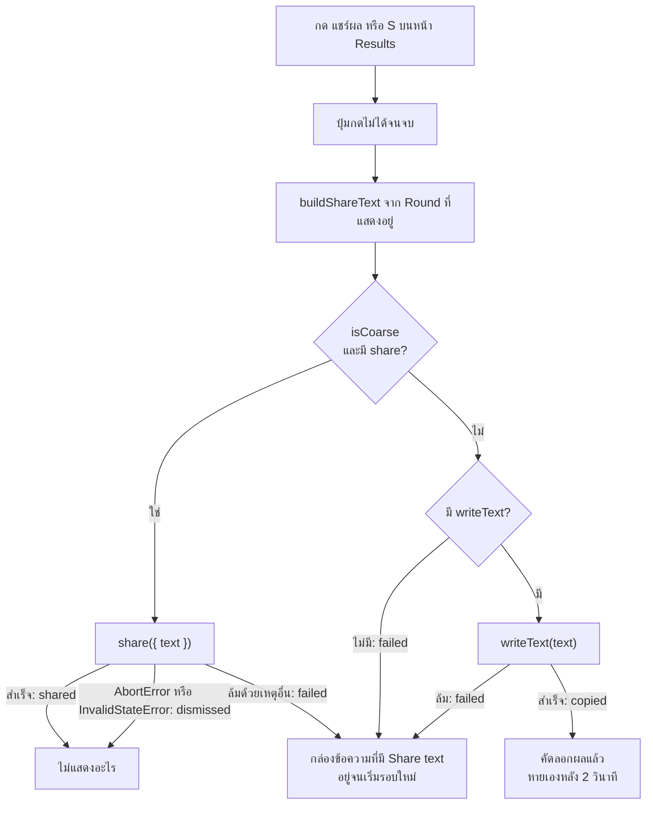

# Flow: share-results

1 diagram, read in this order:
1. สิ่งที่เกิดเมื่อ Player กด "แชร์ผล" หรือ `S` บนหน้า Results

All diagrams use the same names as [spec.md](spec.md).

## 1. กด "แชร์ผล"

**กดแล้วข้อความไปทางไหน และ Player เห็นอะไร**
- share ล้มแล้วไม่ลองคัดลอกต่อ เพราะ activation ของการแตะถูกใช้ไปแล้ว (D7)
- กดซ้ำระหว่าง "คัดลอกผลแล้ว" ยังอยู่ เริ่มนับ 2 วินาทีใหม่และอ่านออกเสียงอีกครั้ง (D7)
- Share text สร้างตอนกดแล้วทิ้ง ไม่มีที่เก็บ (ADR-0001)
- `Tab` ยังเริ่มรอบใหม่ได้ทุกเมื่อ (note-name-quiz D14)
